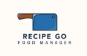
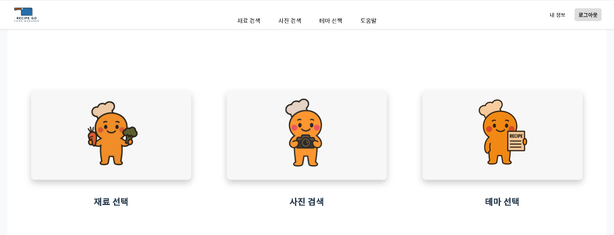

# Recipe Go 로고

## 개요

- 사진 속 재료를 자동으로 인식해 개인 맞춤형 레시피를 추천해주는 AI 기반 서비스입니다.

## 개발 기간

- 2025.06.11 ~ 2025.08.04

## 팀원 구성

 

- 팀명 : OneOrTwo

| **임호규** || **김용준** || **천송현** || **권신영** |

 

---

## front

- 기술 스택: HTML, CSS, JavaScript, React

- 설명 : 사용자 인터페이스를 구현한 프런트엔드 웹 애플리케이션입니다. React 기반으로 동적인 UI를 구성하고 있습니다.
  
 

## backend

- 기술 스택: Python, FastAPI, langchain, RAG(Retrieval-Augmented Generation)

- 설명 : 프런트엔드와 연동되는 API 서버 와 langchain , RAG 를 이용해 Watsonx-ai 와 연동하였습니다.
  
 

## ImageModel

- 기술 스택: YOLOv8/YOLO11(You Only Look Once), WATSONX-AI(llama-4-maverick-17b-128e-instruct-fp8), CLIP(ViT-L-14/openai), ko-sbert-nli (한국어 SBERT 임베딩 모델)

- 설명 : 이미지 탐지를 통해 분석하는 모델입니다. 2단계 파이프라인으로 구성되어 있으며 YOLO 와 CLIP 을 사용하였습니다.
  
 

## ArgoCD

- 기술 스택: Github action, ArgoCD, Kubernetes

- 설명 : CI/CD 파이프라인을 구축하고 Kubernetes 를 통해 배포하였습니다.

 

---

 
## Main Page

메인화면은 세가지의 메인기능으로 구성되어 있습니다.

 
## 재료 선택

- 먼저 재료 선택 페이지 에서는 각 카테고리별로 재료를 선택할 수 있습니다.
 

- 재료 카테고리 +버튼 토글을 통해 원하는 재료를 쉽게 찾을 수 있습니다.
 

- 좌측에서는 선호도와 종류, 난이도를 선택할 수 있습니다.
 

---

# 프로젝트 성과

 

- 2025.08.04

[IBM x Redhat] AI Transformation(AX) Academy 프로젝트 발표회 : 최우수상 (1등)

 

